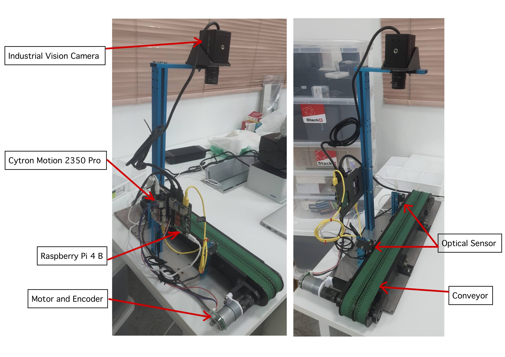

# Box Quality Inspection Conveyor System


*** Report --> docs/Report.pdf ***

Sutthanat Sinthupinyo 6630318321

## Brief overview of the project
  This project is a **machine vision quality inspection system** for boxes on a conveyor, developed with a **Raspberry Pi 4 B** and a **Cytron Motion 2350 Pro** microcontroller using a customized **YOLO** model (ONNX) to detect 5 types of defect on boxes, and uses **OpenCV** to recognize sticker colours on the boxes. The conveyor will stop if the box is defective. There's also a **Flask** web interface dashboard to monitor and log detection results, together with controlling and monitoring the conveyor’s status on the same local Wi-Fi network. No Windows PC, C-drive path, password, or external inference service is required at runtime.

---

## Table of Contents

- [Project Rationale & Scope](#project-rationale--scope)
- [What It Does](#what-it-does)
- [Hardware & Wiring Diagram](#hardware--Wiring-Diagram)
- [Physical Operation & Safety](#physical-operation--safety)
- [Installation on the Raspberry Pi](#installation-on-the-raspberry-pi)
- [Configuration & Data Export](#configuration--data-export)
- [Developer Checks](#developer-checks)
- [Future Work](#future-work)
- [Background & References](#background--references)

---

## Project Rationale & Scope

Visual quality inspection is a routine step in packaging lines. In many small and medium factories, inspection is still performed manually, which is slow, fatiguing, inconsistent, and rarely logged for quality analysis. Commercial automated optical inspection (AOI) systems are often expensive and closed, while rule-based computer vision alone struggles to generalize across diverse defect types (structural damage, missing seals, and surface stains).

This project implements an accessible, embedded mechatronics inspection loop combining deep learning and classical computer vision:
- **Multi-defect detection:** Detects 5 defect classes simultaneously on a single box—**open lid**, **tape defect**, **sticker defect**, **crushed corner**, and **stain**—using a custom YOLO11n model exported to ONNX.
- **Classical CV where rules suffice:** Uses OpenCV for fixed-region cropping (`crop.py`), drawing annotated bounding boxes, and recognizing post-it/sticker colors (`postit_color.py`).
- **Complete mechatronics loop:** Sensing $\rightarrow$ Inspection $\rightarrow$ Decision $\rightarrow$ Sorting/Stopping $\rightarrow$ Logging.
- **Why Raspberry Pi 4 B?** Unlike microcontrollers (e.g., Arduino), the Raspberry Pi provides native USB camera support, sufficient CPU performance for live video and lightweight ONNX inference, strong Python/OpenCV ecosystem support, built upon a strong Raspberry Pi community and compact form factor compared to a mini PC or higher-cost Jetson boards.

**Scope & Limitations:** The system uses a single top-down camera, so side-wall damage is not inspected. Boxes need to be presented in a fixed orientation, and the model was trained on a dataset of 20 boxes of one design under controlled lab lighting.

---

## Hardware & Wiring Diagram

The physical plant consists of a top-mounted industrial vision camera, a Raspberry Pi 4 B, a Cytron MOTION 2350 Pro microcontroller, a 12 V DC gear motor with quadrature encoder driving the conveyor belt, and two optical sensors.

**Overall System**


**Wiring Diagram**


```markdown


```

## Defect classes

## What it does

- **Session Management:** Starts each session at Box No.1 and resets that session's dashboard totals while keeping previous session folders intact.
- **Dual-Sensor Positioning:** Runs the belt forward while waiting for Sensor 1. Sensor 1 does not stop the belt; Sensor 2 is armed in the controller firmware and performs a controlled sensor-land at the box's leading edge.
- **Centering Under Camera:** Measures the travel time from Sensor 1 to Sensor 2 using live controller telemetry, reverses for half the measured time to center the box under the lens, and waits for the conveyor to settle.
- **Vision Pipeline:** Uses the exact `crop_fixed` function from `crop.py` for YOLO ONNX inference and sticker color analysis (`postit_color.py`). The cropped image is saved with each detected defect box annotated.
- **Defect Decision Logic:** Classifies a box as defective if one or more classes exceed the configured confidence threshold. Repeated predictions of the same defect type are counted once per box.
- **Sorting Action:**
  - **Good boxes** are sent forward through Sensor 2 without stopping, then Sensor 2 is re-armed for the next box.
  - **Defective boxes** stop at Sensor 2 and wait for the operator to remove them before resuming forward motion.
- **Logging & Exports:** Logs box number, unique defect types, sticker color, confidence, timestamp, image filename, and detection boxes. CSV exports include session performance totals and per-type defective-box counts; ZIP exports include both CSVs and annotated photos.
- **Live Monitoring:** Streams a live camera view from the existing Pi camera service (avoiding V4L2 device conflicts) to any browser on the local Wi-Fi network.

---

### Bill of Materials (Part List)

| # | Component | Model | Key Specifications | Approx. Price |
| :-: | :--- | :--- | :--- | :--- |
| 1 | **Optical Sensors (x2)** | Keyence PZ2 Series | Photoelectric sensor with built-in amplifier, IP67 waterproof, detects glossy objects | Quote only |
| 2 | **Industrial Vision Camera** | ZWAK-5600 (AR0234) | 1080p, onsemi AR0234 1/2.6" global shutter sensor ($3\ \mu\text{m}$ pixels, $1920 \times 1200$), 2.8–12 mm f/1.4 CS-mount IR-corrected manual lens | 2,738 THB |
| 3 | **DC Gear Motor** | XYT JGB37-3530-CE | Brushed DC gear motor, 12 V, 1,600 RPM, $35\ \text{kg}\cdot\text{cm}$ torque, 0.6 A, 2.5/4.8 W | 205 THB |
| 4 | **Gear Motor with Encoder** | YFROBOT GB37-3530 | 37 mm brushed DC gearmotor, 12 V, 448 CPR quadrature encoder (3.5–5 V supply), 6 mm D-shaft | 1,458 THB |
| 5 | **Single-Board Computer** | Raspberry Pi 4 Model B | Broadcom BCM2711 quad-core Cortex-A72 @ 1.8 GHz, LPDDR4, 5 V / 3 A supply | 1,458–2,754 THB |
| 6 | **Microcontroller** | Cytron MOTION 2350 Pro | RP2350 dual-core Cortex-M33 @ 150 MHz, 520 KB RAM, 2 MB flash, 4x DC motor drivers (10 A max/ch, 3.6–16 V), CircuitPython | 1,123–1,300 THB |

---

### Software Stack
- **Python 3.10+**
- **Ultralytics YOLO11n** (exported to **ONNX** for $640 \times 640$ CPU inference)
- **OpenCV & NumPy** (image cropping, HSV sticker color detection, bounding box annotation)
- **Flask** (local web dashboard and API)
- **PyYAML & Requests** (configuration and inter-service communication)

Codes are in code/ folder.
---

## Physical operation and safety

- **Network Access:** The web server binds to all Pi network interfaces so any device on the local Wi-Fi can open it. **There is no login:** any connected client can start, stop, or emergency-stop the conveyor. Run only on a trusted, isolated network.

- **Start Safety Gate:** The Start button requires operator confirmation that the belt path is clear, a physical emergency stop is accessible, and other conveyor-control applications are idle. The app also checks for fresh controller telemetry, zero velocity/power, clear sensors, and an idle capture workflow before starting. It does not automatically reset a stale controller.

- **Emergency Stop:** Always keep a physical emergency stop accessible. The web emergency-stop button is **not** a substitute for a hardware E-stop.

- **Process Exclusivity:** Do not run the sorter at the same time as any other program that commands the belt or uses the camera. Separate apps do not share a cross-process motion lock.

- **Commissioning Notes:** Commission with the belt clear, an operator at the physical emergency stop, reduced speed, and one box at a time. Verify sensor order, direction, timing, removal, and YOLO decisions before unattended operation. Sensor timing is sampled at a 50 ms telemetry interval (reverse duration is approximate). A YOLO miss is treated as **Good**, so tune your confidence threshold accordingly.

---

## Install on the Pi

Copy this project folder to `~/paml_project/Mechatronics_Project`, including:

- `sorter_app.py`, `templates/index.html`, `crop.py`, and `postit_color.py`
- `best.onnx`, exported for 640 x 640 images with the five classes in the
  configured order
- `config.yaml`, `requirements.txt`, tests, README, and service unit

The Pi camera service must provide 1280 x 720 snapshots on port 9000. The
existing conveyor API must be available on port 8000, and the original capture
interface status API on port 8100. `config.yaml` uses only project-relative
paths for model and session output.

The service uses the Pi's existing Python packages for OpenCV, NumPy, Flask,
PyYAML, and Requests. If a package is missing, install the OS OpenCV bindings
and then install Python dependencies in a virtual environment configured to
see those bindings, or use the distributions supported by your Pi OS. Do not
replace a working system OpenCV installation until ONNX compatibility has
been checked.

After copying the project and confirming that its ONNX model loads, install
and start the service:

```sh
sudo cp paml-box-sorter.service /etc/systemd/system/
sudo systemctl daemon-reload
sudo systemctl enable --now paml-box-sorter.service
systemctl status paml-box-sorter.service
```

Find the Pi's Wi-Fi address with `hostname -I`, then open
`http://<pi-address>:8101/` from a device on the same network. Confirm the
network permits connections to port 8101.

## Configure and export

Edit `config.yaml` to change the listening port, camera/conveyor service URLs,
YOLO threshold, motion limits, default speed, and output directory. Conveyor
speed can also be adjusted from the web page within the configured minimum
and maximum; changes apply at the next motion phase.

The ONNX class order must match `yolo.class_names` and the training dataset.
The supplied crop and sticker-color scripts are the runtime sources of their
respective algorithms; adjust sticker hue and threshold settings in
`postit_color.py` if lighting or labels change.

Each Start creates a new, persistent session directory under `sorting_data/`.
Session box numbering and dashboard counts reset on each Start, while earlier
session folders remain on the Pi. Download the active or most recent session's
CSV/performance and image ZIP from the page before starting another session.

## Developer checks

Python 3.10 or later is required. Run the hardware-free tests from this directory:

```sh
python3 -m unittest -v test_sorter_app
```

The tests cover crop geometry, ONNX output mapping, repeated-defect handling,
CSV/performance output, image export, speed validation, and the Start safety
gate. They mock controller and camera access; they never move the conveyor.
